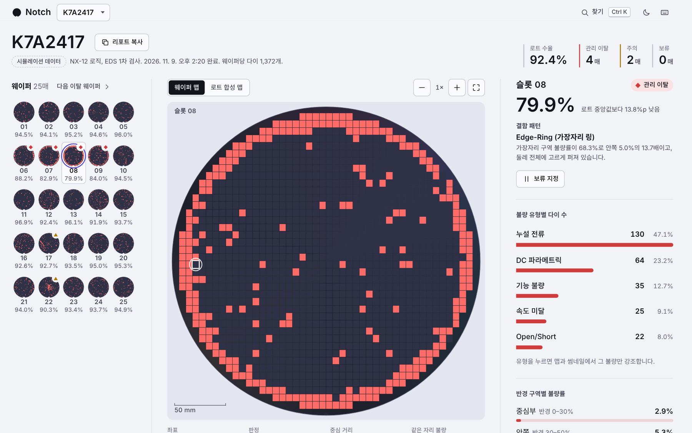
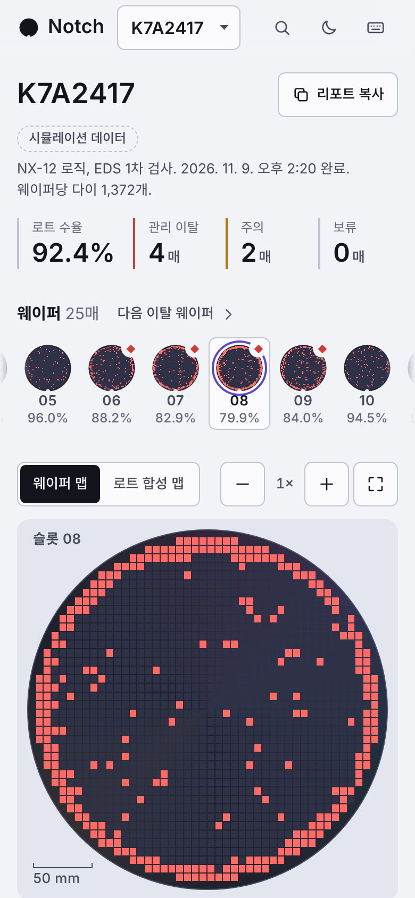
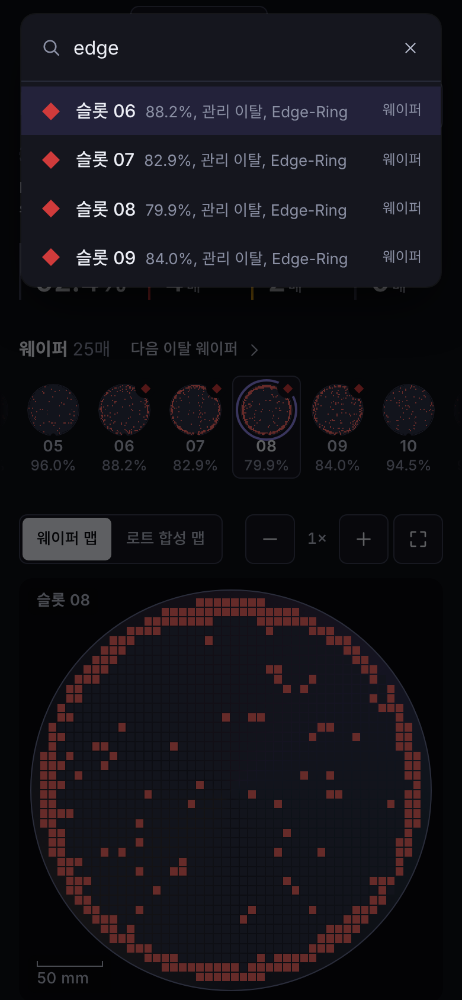
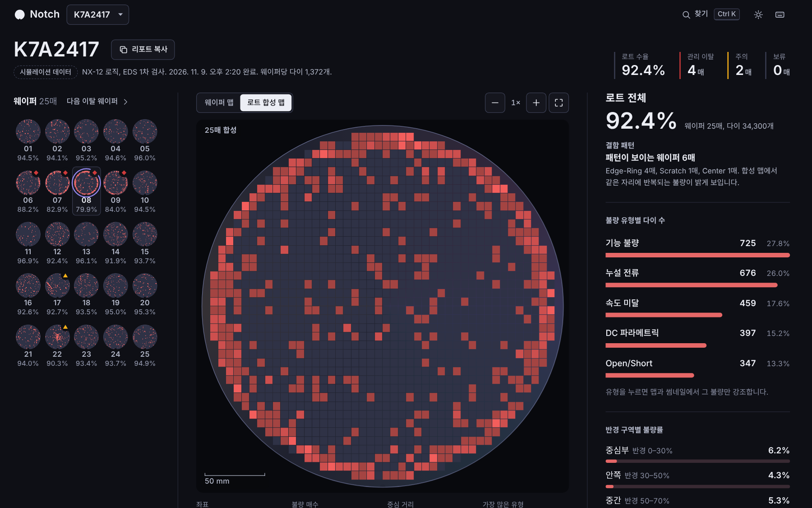

# Notch 웨이퍼 리뷰

반도체 웨이퍼 검사(EDS) 결과를 **로트 → 웨이퍼 → 다이** 순서로 좁혀 보면서, 어느 웨이퍼가 왜 떨어졌는지 찾는 리뷰 콘솔입니다.
프레임워크와 라이브러리 없이 HTML, CSS, JavaScript만으로 만들었고 빌드 결과는 HTML 파일 한 장입니다.



> 화면에 나오는 로트, 웨이퍼, 수율은 모두 고정 시드로 만든 **시뮬레이션 데이터**입니다. 실제 제품이나 공정의 데이터가 아닙니다.

## 바로 보기

- `docs/index.html`을 브라우저로 열면 됩니다. 서버도 설치도 필요 없습니다.
- GitHub Pages를 켜면(Settings → Pages → Branch `main`, 폴더 `/docs`) `https://jhkini.github.io/Notch_wafer/` 에서 열립니다.

<p>
  
  
</p>

## 무엇을 할 수 있나

| 영역 | 내용 |
| --- | --- |
| 로트 요약 | 로트 수율과 관리 이탈, 주의, 보류 매수 |
| 웨이퍼 목록 | 25매 썸네일. 이탈과 주의 웨이퍼에는 모양이 다른 표식이 붙습니다 |
| 웨이퍼 맵 | 다이 단위 bin 맵. 확대와 이동, 다이 하나의 좌표·판정·중심 거리 확인 |
| 로트 합성 맵 | 25매를 겹쳐 같은 자리에서 불량이 난 매수를 보여 줍니다. 설비 문제처럼 반복되는 불량이 드러납니다 |
| 결함 패턴 판정 | 맵만 보고 Edge-Ring, Scratch 같은 패턴을 판정하고 근거를 문장으로 보여 줍니다 |
| 불량 유형 | 유형별 다이 수. 누르면 맵과 썸네일에서 그 유형만 강조합니다 |
| 구역별 불량률 | 중심부에서 가장자리까지 다섯 구역의 불량률 |
| 수율 관리도 | 슬롯별 수율과 관리한계. 차트와 표를 오갈 수 있습니다 |
| 찾기와 명령 | 슬롯 번호, 패턴 이름, 명령을 한 곳에서 검색해 실행합니다 |
| 보류 지정 | 웨이퍼를 보류로 표시하고 바로 되돌릴 수 있습니다. 이 브라우저에만 저장됩니다 |
| 리포트 복사 | 로트 요약을 텍스트로 복사합니다 |



## 조작법

| 입력 | 동작 |
| --- | --- |
| `Ctrl`/`⌘` + `K`, `/` | 찾기와 명령 |
| `J` `K` | 다음, 이전 웨이퍼 |
| `N` (`Shift`와 함께 누르면 반대 방향) | 다음 이탈 웨이퍼 |
| `M` | 웨이퍼 맵과 로트 합성 맵 전환 |
| `H` | 보류 지정, 해제 |
| 방향키 (맵에 초점) | 다이 이동 |
| `+` `−` `0` (맵에 초점) | 확대, 축소, 전체 보기 |
| `Esc` | 다이 선택 → 강조 → 확대 순서로 해제 |
| 두 손가락 벌리기, 두 번 누르기 | 맵 확대 |
| 좌우로 밀기 (전체 보기 상태) | 이전, 다음 웨이퍼 |
| `Ctrl` + 휠 | 마우스 위치 기준 확대. 그냥 휠은 페이지 스크롤로 남겨 둡니다 |

## 설계에서 신경 쓴 부분

### 구조

- **순수 로직과 화면을 나눴습니다.** `src/core.js`는 DOM을 전혀 건드리지 않습니다. 난수, 다이 배치, 데이터 생성, 통계, 패턴 판정이 여기에 있고 Node에서 그대로 테스트합니다. `src/app.js`는 그 위에 화면을 얹습니다.
- **상태는 한 방향으로 흐릅니다.** 입력 → action → `store.set` → 렌더러. 렌더러는 직전에 그린 상태와 비교해 바뀐 조각만 다시 그립니다. 저장소는 라이브러리 없이 직접 만든 작은 것입니다.
- **주소가 상태를 담습니다.** `#k7a2417-08`처럼 로트와 슬롯이 주소에 들어가서 특정 웨이퍼를 링크로 공유할 수 있습니다. 기록을 쌓지 않도록 `location.replace`로 바꿉니다.
- **데이터에서 온 문자열은 `textContent`로만 넣습니다.** `innerHTML`은 쓰지 않습니다.

### 웨이퍼 맵

- 캔버스에 직접 그립니다. 기기 픽셀 배율에 맞춰 해상도를 잡고, 다이 경계를 기기 픽셀에 맞춰 흐려지지 않게 했습니다.
- 같은 색 다이를 한 경로로 묶어 한 번에 칠합니다. 1,372개 다이를 색 개수만큼의 `fill`로 끝냅니다.
- 썸네일은 다이 하나를 픽셀 하나로 찍은 작은 비트맵을 확대해 붙입니다. 25매를 사각형으로 하나씩 그리는 것보다 훨씬 쌉니다.
- 터치는 Pointer Events 하나로 처리합니다. 전체 보기에서는 세로 스크롤을 페이지에 양보하고(`touch-action: pan-y`), 확대하면 모든 제스처를 맵이 받습니다.
- 캔버스는 CSS 변수를 모르기 때문에 테마가 바뀔 때 토큰 값을 다시 읽어 그립니다. 호스트가 속성으로 바꾸든 OS 설정이 바뀌든 같은 경로를 탑니다.

### 결함 패턴 판정

생성기가 어떤 패턴을 넣었는지는 참조하지 않고, 맵의 구역 통계와 불량 군집 모양만으로 판정합니다. 패턴 이름은 공개 데이터셋 WM-811K의 분류를 따랐습니다. 위에서부터 순서대로 검사합니다.

| 순서 | 패턴 | 기준 |
| --- | --- | --- |
| 1 | Near-full | 불량률 55% 이상 |
| 2 | Random | 불량률 13% 이상이고 구역 간 차이가 표본 오차 수준 (카이제곱 ≤ 20, 자유도 4) |
| 3 | Edge-Ring, Edge-Loc | 가장자리 구역 불량률 22% 이상이면서 안쪽의 2.5배 이상. 둘레에 고르면 링, 한 방향에 몰리면 국부 |
| 4 | Center | 중심부 불량률 22% 이상이면서 바깥쪽의 3배 이상, 가장 큰 군집이 중심에 있음 |
| 5 | Donut | 반경 30~70% 구간 불량률 16% 이상이면서 중심부와 가장자리의 2배 이상, 고리 모양으로 고름 |
| 6 | Scratch | 가장 큰 군집이 다이 7개 이상, 길이 35 mm 이상, 길이가 폭의 3.4배 이상 |
| 7 | Loc, Edge-Loc | 가장 큰 군집이 다이 9개 이상. 위치가 반경 70% 바깥이면 가장자리 국부 |

군집의 길이와 폭은 양 끝 범위가 아니라 주성분 분산으로 잽니다. 옆에 붙은 배경 불량 한두 개에 폭이 흔들리지 않게 하려는 선택입니다.

패턴 9종을 300장씩, 무작위 시드 2,700장으로 돌린 결과 **98.8%**가 생성 패턴과 일치했습니다. 가장 약한 것은 Scratch(300장 중 284장)이고, 정상 웨이퍼를 패턴으로 잘못 본 경우는 300장 중 1장입니다. `npm test`를 실행하면 혼동 행렬이 출력됩니다.

### 관리한계

개별값 관리도(X chart)를 쓰되 평균 대신 중앙값으로 계산합니다.

- 중심선 = 25매 수율의 중앙값
- 관리한계 = 중심선 ± 3.145 × 이동범위 중앙값 (σ̂ = 이동범위 중앙값 ÷ 0.9539)

평균과 평균 이동범위를 쓰면 이상 웨이퍼 몇 장이 한계를 넓혀서 스스로를 가립니다. 중앙값 기반으로 잡으면 그 영향을 받지 않습니다.

### 합성 맵의 계급

배경 불량(약 5%)만으로도 25매를 겹치면 자리마다 1~2매씩 쌓입니다. 그대로 칠하면 맵 전체가 붉어져 반복 불량이 묻히므로 전체 불량은 3매부터 색을 줍니다. 유형 하나만 볼 때는 배경이 훨씬 낮아 1매부터 셉니다. 범례가 항상 실제 계급을 보여 줍니다.

### 접근성

- 모든 기능을 키보드로 쓸 수 있습니다. 웨이퍼 목록과 관리도는 초점 하나를 방향키로 옮기는 방식(roving tabindex)입니다.
- 캔버스 맵은 방향키로 다이를 옮기면 좌표와 판정을 화면 낭독기에 읽어 줍니다.
- 상태는 색만으로 구분하지 않습니다. 이탈은 마름모, 주의는 삼각형 표식과 글자가 함께 갑니다.
- 차트에는 같은 내용의 표가 있습니다.
- `prefers-reduced-motion`, `prefers-contrast`, 강제 색상(고대비) 모드에 대응합니다.
- 글자 단축키는 `event.code`로 받아서 한글 입력 상태에서도 동작하고, 검색창에서는 조합 중인 Enter를 실행으로 처리하지 않습니다.

### CSS

- 토큰 → 레이어(`reset`, `base`) → 레이아웃 → 컴포넌트 → 환경 대응 순서로 한 파일에 정리했습니다. reset과 base만 `@layer`에 넣어서 컴포넌트 규칙이 명시도 싸움 없이 이깁니다.
- 밝은 테마와 어두운 테마를 각각 설계했고, 맵과 차트 색은 대비를 계산해서 정했습니다.
- 컴포넌트 단위 반응형은 컨테이너 쿼리로, 페이지 배치는 미디어 쿼리로 나눴습니다.
- "하나를 강조하면 나머지 막대가 회색이 된다" 같은 상태 표현은 `:has()`로 처리해서 상태가 `aria-pressed` 한 곳에만 있습니다.
- 최신 기능은 없어도 동작하도록 얹었습니다: View Transitions(테마 전환, 로트 전환), 스크롤 연동 애니메이션(목록 가장자리 흐림, 상단 바 경계선), `@starting-style`(대화상자 등장과 퇴장), Popover API와 앵커 위치 지정(정보 팝오버), `@property`, `linear()` 이징.

### 견고함

- 브라우저 저장소에서 읽은 값은 검증한 뒤에만 씁니다. 저장소가 막혀 있어도 화면은 그대로 동작합니다.
- 클립보드가 막힌 환경에서는 직접 복사할 수 있는 대화상자를 대신 띄웁니다.
- 있어야 하는 요소가 없으면 조용히 넘어가지 않고 바로 오류를 냅니다.

## 폴더 구조

```
src/
  index.html    마크업과 아이콘. 스타일과 스크립트가 들어갈 자리가 비어 있는 틀
  styles.css    토큰, 레이어, 레이아웃, 컴포넌트, 환경 대응
  core.js       순수 로직: 난수, 다이 배치, 데이터 생성, 통계, 패턴 판정, 검색
  app.js        화면: 상태 저장소, 캔버스 맵, 관리도, 렌더러, 입력 처리
docs/
  index.html    빌드 결과. src를 합친 한 장짜리 파일 (직접 고치지 않습니다)
test/
  core.test.mjs   로직 단위 테스트
  e2e.py          브라우저에서 실제로 조작해 보는 점검
  screenshots.py  이 문서의 화면 캡처를 다시 만드는 스크립트
build.mjs       src 네 파일을 docs/index.html 한 장으로 합칩니다
```

## 개발

Node 20 이상이 필요합니다. 빌드와 단위 테스트에는 설치할 패키지가 없습니다.

```bash
npm run build       # src → docs/index.html
npm test            # 로직 단위 테스트 (Node 내장 테스트 러너)
```

타입 검사와 브라우저 점검은 도구가 더 필요합니다.

```bash
npm install         # TypeScript (타입 검사용)
npm run typecheck   # JSDoc 주석으로 src/*.js 타입 검사

pip install playwright && playwright install chromium
npm run test:e2e    # 빌드한 뒤 모바일, 태블릿, 데스크톱 화면에서 조작 점검
```

브라우저 점검은 화면 크기와 테마를 바꿔 가며 79개 항목을 확인합니다. 터치 누르기, 밀기, 두 손가락 확대도 실제 터치 이벤트로 보냅니다.

소스를 고친 뒤에는 `npm run build`로 `docs/index.html`을 다시 만들어 함께 커밋합니다.

## 브라우저 지원

CSS 중첩, `:has()`, 컨테이너 쿼리, `color-mix()`를 기본으로 쓰기 때문에 2023년 말 이후의 브라우저가 필요합니다. 자동 점검은 Chrome에서만 돌렸고, Safari와 Firefox는 직접 확인하지 못했습니다.

## 한계와 다음 단계

- 데이터가 시뮬레이션입니다. 실제 맵을 붙이려면 `core.js`의 `buildLot`이 웨이퍼별 bin 배열을 받도록 바꾸면 됩니다. 다이 배치가 다르면 `buildGeometry`의 규격도 맞춰야 합니다.
- 판정 기준값은 이 생성기의 데이터에 맞춰 잡은 값입니다. 실제 데이터에서는 다시 보정해야 합니다.
- 한 웨이퍼에 패턴이 둘 이상 겹쳐 있으면 먼저 걸린 하나만 판정합니다.
- 서버가 없습니다. 보류 지정은 브라우저에만 남고 다른 사람과 공유되지 않습니다.
